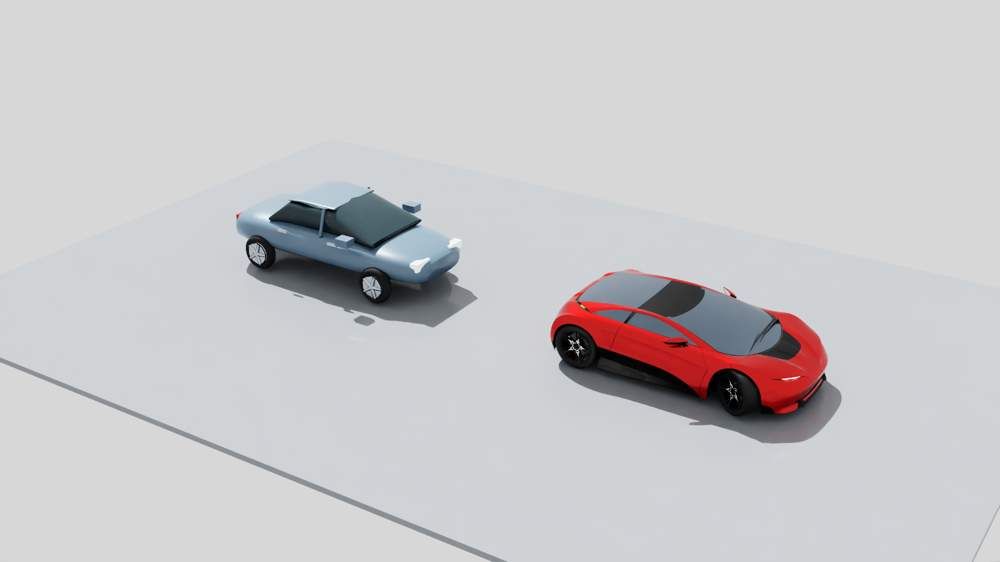
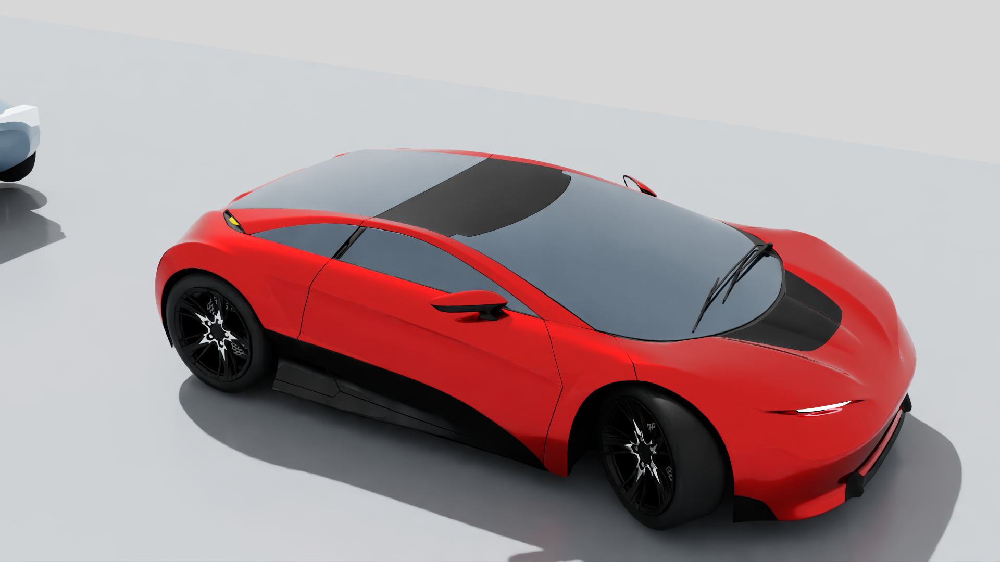

# CarConcept static vehicle benchmark

The licensed CarConcept derivative passes a bounded static geometry and appearance benchmark. The actual October 30, 2026 comparison and detail renders show substantially better body curvature, wheel/arch detail, mirrors, seams, wipers and lamps than the depicted procedural prototype. V3 replaces failed milky glazing with an explicitly opaque reflective tint. It has **not been adopted into the district**, and this does not complete ticket #10.

The [independent review](evidence/car-concept-review.json), dated November 2, binds original files, converted assets and all four actual images to their hashes. It accepts one isolated concept-car benchmark, not native PBR fidelity or district readiness.

## Source, license and attribution

**CarConcept — © 2024 Darmstadt Graphics Group GmbH. Model and textures by Eric Chadwick.** Distributed under [Creative Commons Attribution 4.0 International](https://creativecommons.org/licenses/by/4.0/) by the [Khronos glTF Sample Assets repository at the pinned commit](https://github.com/KhronosGroup/glTF-Sample-Assets/tree/8f492390ddc7a2ae221a1369ef560589cf8c70fb/Models/CarConcept). The publisher's [license](https://github.com/KhronosGroup/glTF-Sample-Assets/blob/8f492390ddc7a2ae221a1369ef560589cf8c70fb/Models/CarConcept/LICENSE.md) excludes logos and associated trademarks. No endorsement is implied.

Modifications: static GLB-to-USD conversion, Y-up to Z-up conversion, derivative image-row orientation, removal of license-plate geometry, omission of the Khronos logo atlas and branded tire base/normal textures, and simplified default Carmine materials. V3 additionally uses opaque dark reflective glazing without transmission or refraction. Original source bytes remain unchanged.

The local derivative includes `ATTRIBUTION.md` and `SOURCE_LICENSE.md`. Any redistributed model or derived render must carry the attribution, source/license links and modification notice above. This document does not grant rights to unrelated assets or excluded marks.

| Pinned input or accepted derivative | SHA-256 |
| --- | --- |
| Source commit | `8f492390ddc7a2ae221a1369ef560589cf8c70fb` |
| Original `CarConcept.glb` | `c272098089d78c5cd9fd9f24ff50ee8acf8d932c55f2d55fc10adb6c8998966b` |
| Source acquisition receipt | `9b9168ab80a1514cd0ac4cfd48bfaa65d709c434426d725d186cd82f56deabd8` |
| V3 `car.usda` | `28737a869c9ee1ac0fd96abd9c847f385c842c71c78446ca95dd93005132cc7b` |
| V3 `manifest.json` | `f38953e2a508bc54ce1ef6b1cd37e5b37fd1ac7c35003b6eed60a6c5705c7cf0` |

## Converter contract and replay

[The converter](../tools/convert_car_concept.py) reads the exact pinned GLB, README, license, metadata and `acquisition.json` from `data/diagnostics/car_concept_20261030/source/`. It verifies the receipt's file hashes and the separately pinned GLB hash before conversion. It supports this static embedded-buffer asset's dense FLOAT/USHORT accessors and matrix/TRS hierarchy; it rejects unsupported sparse/normalized accessors, animations, skins, morphs, primitive modes, invalid indices, nonfinite values and buffer overruns.

Requirements are the existing project `.dependencies` providing USD, NumPy and Pillow, plus the local source cache and current composed scene/prototype used for the comparison. Conversion performs no downloads or installs. It creates a **fresh output directory** and refuses any existing directory, preserving earlier candidates. Failed builds may leave an incomplete new directory: inspect the error and select another fresh destination rather than treating partial files as complete.

From the repository root, reproduce the V3 mode into a new directory:

```powershell
$env:OMP_NUM_THREADS = '1'
$env:OPENBLAS_NUM_THREADS = '1'
$env:MKL_NUM_THREADS = '1'
$env:PXR_WORK_THREAD_LIMIT = '1'
python tools/convert_car_concept.py --source data/diagnostics/car_concept_20261030/source --output data/diagnostics/car_concept_20261030/replay_v3 --glass-mode tinted-opaque
```

Use the project Python environment that can import the existing dependencies. The default `--glass-mode source-opacity` reproduces the earlier appearance choice; **it is not the accepted V3 mode**. This helper is specific to the pinned source, not a general glTF converter.

Outputs are `car.usda`, flipped unbranded texture dependencies, `review.usda`, `compare.usda`, attribution/license files and a manifest of source/tool/output hashes, counts and limitations. `review.usda` is a contained vehicle inspection scene; `compare.usda` also references the actual composed current prototype, so that comparison is project-dependent. Both explicitly author Z-up/meters. Neither changes the active scene, instance placements, manual edits or editor session. No render launches automatically.

The generated camera paths are `/Review/Camera` and `/Comparison/CompareCamera` plus `/Comparison/CandidateDetail`. Actual captured evidence below uses separate capture-wrapper camera names. A replay against a later project root is a new comparison, not proof of identical historical pixels.

## Actual results and limits

The source's 101 nodes and 97 meshes yield 108 converted primitive meshes after plate exclusion: **162,718 vertices and 213,313 triangles**. Independent reconstruction confirms original positions, indices, normals, raw UVs and tangents, with maximum world-vertex difference `8.88e-16 m`. Native meter scale is retained: approximately 2.542 m wide, 4.357 m long and 1.149 m high. Comparison-only ground adjustment is approximately 0.000241 m; this is not parking or terrain fitting.

| Actual capture | Result |
| --- | --- |
| V2 `data/renders/20261030T163437Z/VehicleComparison.png` and `VehicleDetail.png` | Detailed body/wheels improve on prototype; opacity-based glazing is milky and triangle-patterned. Glazing appearance rejected. |
| V3 `data/renders/20261030T165216Z/VehicleComparison.png` and `VehicleDetail.png` | Same geometry with dark reflective glazing; previous milky triangle pattern absent in both inspected views. Accepted as the declared opaque-tint benchmark. |

Each complete image is 1920×1080, captured with explicit Z-up/meters. The review records image and capture-manifest hashes. These are historical October 30 comparisons, re-reviewed November 2. The independently reconciled root subsequently added campus hardscape; this is not a current full-scene vehicle capture. The two V3 images below are exact copies of those reviewed captures.





Both images: CarConcept © 2024 Darmstadt Graphics Group GmbH; model/textures by Eric Chadwick, [CC BY 4.0](https://creativecommons.org/licenses/by/4.0/), [pinned source](https://github.com/KhronosGroup/glTF-Sample-Assets/tree/8f492390ddc7a2ae221a1369ef560589cf8c70fb/Models/CarConcept). TWIN USD conversion, orientation/texture changes, logo/plate/tire-map exclusions and opaque tinted glass as described above. No endorsement.

Material coverage includes default Carmine base color, metallic/roughness, scalar clearcoat, emissive strength and supported UV transforms/samplers. Other color variants are not authored. Tangent normal maps, AO and iridescence are omitted; retained tangents are source data, not proof those maps render. V3 glazing has opacity 1: interior visibility, physical transmission and refraction are **not delivered**. No readable brand marks appear in the inspected views; the excluded plate and texture bindings were independently checked.

Before district adoption, remaining work includes an accepted LOD/performance budget for this triangle count, actual district frame/memory measurements, suitable sedan/SUV/van variety, parking/stall fit, varied-ground wheel contact and collision/clearance checks. One wide, low concept car does not establish local vehicle distribution or live traffic behavior. The benchmark has no active replacement or whole-ticket acceptance.
