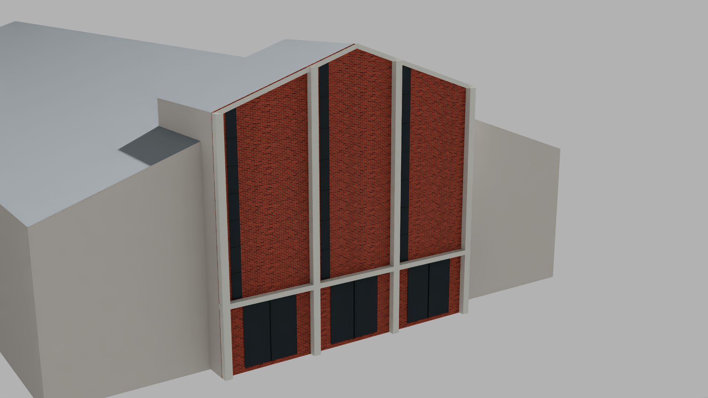

# Church on the Drive entrance proposal

October 30, 2026. Existing building tickets #6/#8/#11/#13. The proposal is separate and inactive; no whole ticket closed.

The official OCPA exterior for parcel `292214146005190` visibly captions **1914 Edgewater Drive, November 8, 2021, 12:04 PM**. It shows a raised central entrance gable, four pale vertical frames, narrow dark glazing, masonry and a steeple. The other campus parcel's image shows a different flat-roof brick building. This resolves the earlier tentative hip interpretation and avoids combining two building fronts. Retrieval time does not establish a newer exterior observation.

The revised roof candidate uses the original 2018–2019 public point cloud to fit the raised central return. Independent source/photo and serialized geometry review passed with explicit source-cell outline and wall-line uncertainty. The 2021 photograph corroborates architectural form; 2026 conditions remain unverified. [Roof review](evidence/church-sanctuary-v3-review.json).

`tools/prepare_church_frontage.py` adds a separate photo-interpreted appearance layer: four pale piers, gable trim, dark vertical glazing and lower entrance glazing over original procedural masonry materials. Frame thickness, divisions, door layout, material tone and proportions are estimates. No source photograph pixels become a texture. The measured/source-derived roof frame and estimated appearance remain distinct.



Independent review accepts this bounded estimated appearance proposal: the entrance motif is recognizable, geometry/material resources resolve, and the actual sharp 1920×1080 Z-up/meters image has no missing resources, detached frames or the earlier rendering artifacts. A thin red edge near the gable trim remains a junction approximation. Generic side masses, omitted wings, steps/site context and the absent steeple keep whole-building realism unaccepted. [Appearance review](evidence/church-frontage-appearance-review.json) · [Actual capture](evidence/church-entrance-render.json).

## Preparation and preservation

```text
python tools/prepare_church_frontage.py --output data/diagnostics/<new-folder>
```

The helper requires the frozen v3 site/manifest, its source dependencies and original dated photo, the active snapshot and existing original TWIN masonry material/textures. It validates hashes and snapshot lineage before output, rejects existing/outside output folders, and checks composed resources plus preservation of source, root and manual bytes. No network, activation, editor save or source-image publication occurs. Output includes appearance/review USD and a provenance manifest under ignored diagnostics.

Snapshot, stale-source and existing-output failures were checked independently; the v3 shell's composed attributes and world transform are unchanged by appearance. Keep the frozen package `data/diagnostics/church_frontage_20261030` and captured helper snapshot for reproduction. Removing the proposal has no effect on the active scene.

## Next acceptance work

Original returns independently support a narrow historical steeple cluster and an approximate taper. The highest return is not a verified physical tip; louver walls and slot dimensions are unmeasured. A separately labeled photo-estimated enclosure may connect the roof to the observed cap, but must not be presented as measured. [Steeple source audit](evidence/church-steeple-source-review.json).

Complete the architectural assembly, reconcile exact legacy fragments, inspect the combined actual image and preserve the remaining campus before any bounded historical integration. Source dates, estimated details and currentness limits remain visible; this proposal does not establish current use, tax-building linkage or a finished block.

## Combined historical assembly review — November 2, 2026

The extended helper's `--with-steeple` mode combines the frozen observed-return spire with a separately photo-estimated white enclosure, cap and louver appearance. Hidden enclosure sides are plain closure; 18 blades on each visible face are an appearance estimate, not counted/measured louvers. The highest observed return bounds the nominal proxy apex; the true physical tip remains unknown. A second appearance override supplies masonry and dark roofing, with nondegenerate dominant-plane UVs while preserving the source shell's points, topology and normals.

```text
python tools/prepare_church_frontage.py --with-steeple --output data/diagnostics/<new-assembly-folder>
python tools/prepare_church_legacy_mask.py --output data/diagnostics/<new-mask-folder>
```

Both prepare fresh ignored candidates, with no activation, source writes, editor saves or network access. The assembly depends on the frozen entrance/roof, original steeple evidence, original masonry and their source/hash guards. The mask helper reuses partial original-surface subtraction rather than making a new parcel extrusion; it checks exact original group/source IDs, retains source face elevations/materials and interpolates original affine UVs. An error may leave a partial new directory; only a completed manifest and review establish a usable candidate.

The independent [legacy remainder review](evidence/church-legacy-mask-review.json) verifies that Building_2919 is a bounding-box false positive with no actual overlap; its original surfaces remain intact. Building_3065 retains 87.048 m² outside the replacement projection, at its original elevations and with its original identity/material metadata. No raw tax link or physical-building identity is promoted. [Initial assembly review](evidence/church-assembly-visual-review.json) required suppression of unrelated illustrative STUDIO/MARKET fronts; the revised appearance suppresses only those two generated campus storefront groups, preserving their raw building masses.

The first revised captures still had global road/wall artifacts. Correcting 18 zero-area bottom-face UVs was necessary but did not eliminate those artifacts. The subsequent actual capture, `data/renders/20261102T155708Z/ChurchAssembly.png`, waits for 60 viewport frames **before** scheduling capture and shows coherent entrance, masonry, roof and attached steeple without the previous global bands. The old and new C captures have identical scene-layer hashes, camera and physical metadata. [Independent controlled image review](evidence/church-frame-gate-review.json) and [SDK findings](evidence/viewport-capture-sdk-review.json) support the bounded capture correction; they do not prove shader convergence or unique root cause. The exact captured helper is archived locally by its recorded SHA.

The combined church remains inactive. Current conditions, exact wall/overhang and tip dimensions, complete side/wing façades, steps/ramps/site connections and full-building presentation remain unaccepted. Local preservation/rebuild integration must pass before historical composition; no whole ticket is closed. Original photos/aerials and generated local review scenes remain outside the public repository.

The [canonical integration preparer](CHURCH_INTEGRATION_CONTRACT.md) now extracts only the selected church components, precise legacy mask and required materials into one local layer, with no review cameras, paving or full-scene nesting. Actual preparation compared 1,980 attributes and world transforms to C and preserved six protected files. This is a prepared candidate; application remains separate.
