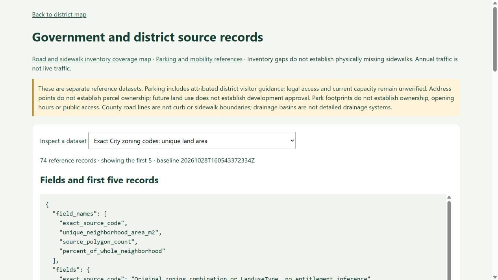

# Parcel zoning and future-land-use references

October 30, 2026 · Existing tickets #4 and #14, with parcel context for #3/#32.

The app provides full-neighborhood City planning references matched to OCPA parcel-feature geometry. Exact source zoning strings, lexical suffixes, PD names and source format dates stay attached to each intersecting polygon. Multiple intersections remain visible instead of selecting one zoning code for an entire parcel.

| Table | Records | API |
|---|---:|---|
| Parcel planning context | 5,723 | `/api/v1/city_planning_parcel_context` |
| Exact zoning-code land areas | 74 | `/api/v1/city_planning_zoning_areas` |
| Future-land-use land areas | 19 | `/api/v1/city_planning_future_land_use_areas` |

Use the [source browser](http://127.0.0.1:8768/source-browser?source=city_planning_parcel_context) for field definitions, the first five rows, source records and a zoning coverage graphic. Each table supports `limit` and `offset`; parcel context also supports exact `parcel_id`. The quality endpoint is `/api/v1/city_planning_quality`. Table and quality responses carry the same checked packet hash.

There are 5,721 distinct parcel-ID strings, 716 feature records intersecting multiple exact zoning codes, and 303 requiring PD-condition review. These are source-feature contexts, not physical property counts or verified legal split-zoning findings. Source code tokens are preserved lexically; no commercial, residential, townhouse or development entitlement is assigned from a guessed abbreviation.

## Coverage and outstanding source work

Land-area calculations use EPSG:32617 square meters and the complete official neighborhood/Main Street boundaries. Unique polygon unions are reported separately from source-feature area sums. Overlapping parcel records contribute approximately 254,407 m² of excess feature-summed area; adding tax-row areas would overstate represented land.

Valid zoning coverage is approximately 91.92% of the neighborhood and 96.69% of Main Street. FLU coverage is approximately 99.98% and 96.69%, respectively. Parcel polygon union coverage is a separate cadastral representation measure, not 3D extraction coverage. Road/water gaps and source boundaries require interpretation.

Three invalid City polygons are quarantined without repair: zoning OBJECTIDs 1877 and 2084, and FLU OBJECTID 1847. Nine tiny parcel-boundary intersections excluded by the explicit 0.01 m² area floor explain the difference from the earlier 5,732-row ownership-reference inventory. This numerical floor does not establish positional accuracy.

Governing ordinances, PD amendments, overlay conditions and effective dates still need verification. Zoning/FLU does not establish current use, ownership, vacancy or approved development. No scene geometry or active source snapshot changes in this delivery. Broader ticket #4 remains open.

## Script and publication contract

`tools/city_planning_reference.py` reuses bounded official ArcGIS queries and cached originals. Default execution is offline; `--live` fills missing public requests. It preserves source OBJECTIDs and parcel strings, retains invalid-source exceptions, and refuses overwriting unreceipted or modified outputs. Receipts bind packet, coverage SVG, feature geometry, source dependencies, implementation and active snapshot. Prior outputs are backed up before a checked rebuild.

```text
python tools/city_planning_reference.py
python tools/city_planning_reference.py --live
```

Outputs remain local under `data/processed/city_planning_reference`. API requests read checked cached packets and make no agency calls. Only approved planning/parcel reference fields are returned; owner/contact data and imagery are excluded. Remove the optional routes/UI options to roll back publication; retain source caches and later user work.

Independent source review reconciled original feature populations, all exact-code unions, both scope denominators and twelve brute-force parcel intersection samples. Separate integration review checked real HTTP pagination, exact parcel filtering, fields/previews, packet versions, stale/error handling, coverage bytes and preservation of the existing parks default. Three focused tests cover overlapping-area accounting, code preservation and manual-output protection.

[Delivery summary](evidence/city-planning-delivery.json) · [Source review](evidence/city-planning-source-review.json) · [API/UI review](evidence/city-planning-integration-review.json)


