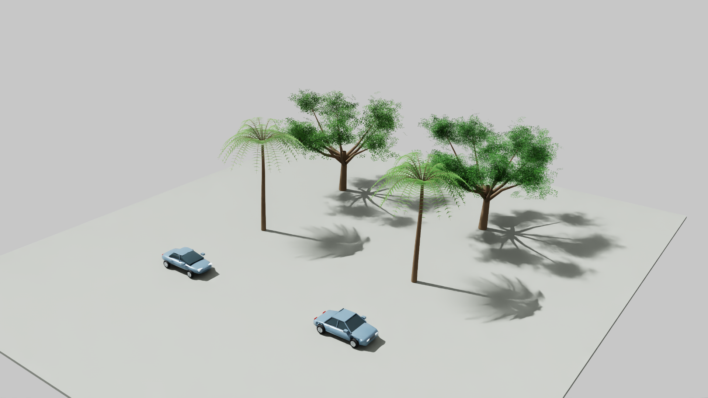

# Trees and cars: actual visual review

October 29, 2026. Tickets #9 and #10 remain open.

`tools/build_environment_candidate.py` prepares isolated replacements from existing original TWIN assets. It preserves all five tree instance arrays and all 87 car world transforms, and does not activate layers. Use a new diagnostic output directory. No new placement, parking-clearance or species accuracy is implied.

The first actual comparison exposed detached rear lights, oversized front lamps and an angular car body. Independent review rejected activation despite passing CPU geometry and placement-preservation checks. Oak crown fullness improved, while palms remained sparse and wire-like. [Independent review](evidence/environment-v3-review.json).

A second frozen candidate, `data/diagnostics/environment_v3_20261029_c`, corrected the lamp placement and connected/tapered the body panels. The actual second comparison below shows those corrections. Left is the currently composed prototype; right is the candidate. This is an isolated asset view, not district performance or placement acceptance.

The corrected candidate is still generic and the palms remain thin. No district asset replacement was activated. The next quality step is evaluating authored production assets with their original materials and physical dimensions, as recorded in [verified source candidates](REALISTIC_ASSET_SOURCES.md). A jacaranda quality benchmark must not be relabelled as a live oak. Downloads, compatibility, visual benefit and performance must be demonstrated before adoption; a marketplace listing is not an acquired asset.

Frozen manifests preserve file hashes, camera names, approximate mesh budgets and source-root identity. Actual captures are under `data/renders/20261029T162344Z` and `20261029T162751Z`. The source-preservation count reported by the builder is qualified in independent evidence because a full stored pre-build hash map was not supplied. The approved runtime scene and user's editor remain separate from these proposals.
