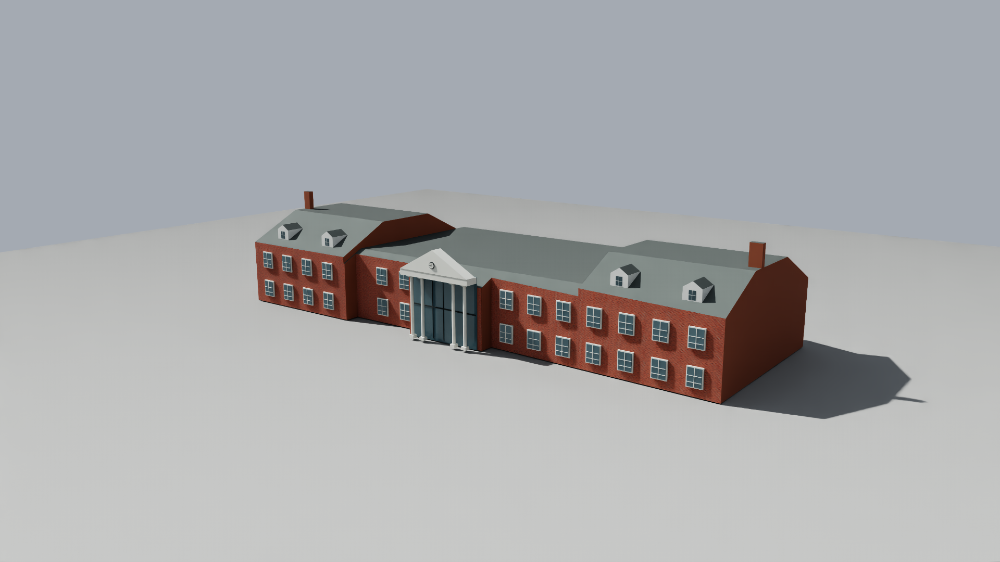
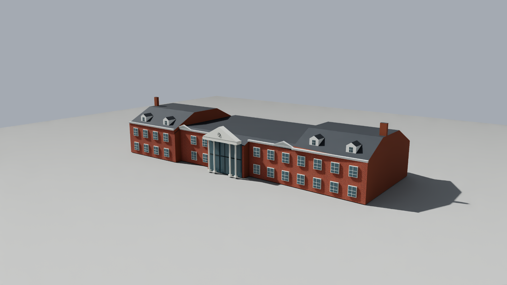
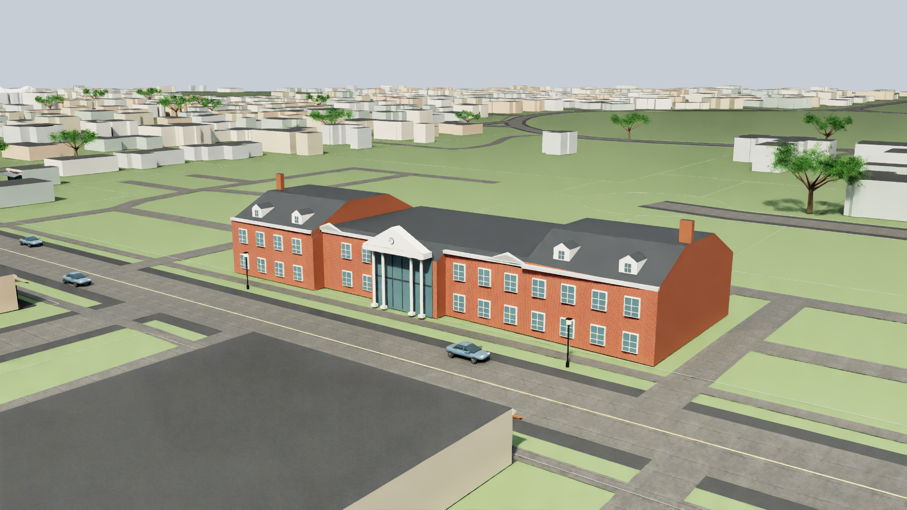

# Office frontage detail review

October 29, 2026. Tickets #6/#8/#11/#32 remain open. This is one appearance improvement within the full Main Street building queue.

The existing 1615 Edgewater draft is recognizable as the two-storey brick office with a central clock portico, dormers and chimneys. Its first actual review still missed the smaller front pediments and continuous pale cornice, and the roof appeared lighter than the address-specific broker photographs. Window rhythm, side openings, roof proportions and present-day condition remain unresolved. The historical cloud is from 2018–2019; the brochure photograph capture date is unknown.

`tools/refine_office_frontage.py` reuses that existing frontage and roof assembly. It produces a detail-only delta: ten wall-following cornice segments, two small front pediments with approximate proportions, and an original darker roof material. It does not replace the historical roof mesh, alter building heights or infer unseen rear details. Source photos are qualitative references; no photo pixels, logos or contact details are embedded in the model or committed images.

## Script contract

- Inputs: `scene/office_frontage_review.usda` and its used layers; existing address-specific broker reference pages 3/4/9 under ignored local imagery.
- Units: existing project local coordinates, metres, Z up. No new georeferencing or height datum transformation.
- Execution: `python tools/refine_office_frontage.py --output data/diagnostics/<new-review-name>`.
- Publication: requires a new contained output directory. Existing outputs are refused. No network, active pointer update, scene reload, activation or source write.
- Outputs: `detail.usda`, a `workview.usda` using the unchanged camera/lighting, and a manifest with source/photo hashes and interpreted dimensions. Raw references remain local.
- Verification: inspect actual same-camera renders and review the composed source geometry. Added architectural proportions are estimates; a better picture does not certify survey/currentness. Adoption requires exact compatibility with the active office and independent review. The scene builder now retains the layer only when its activation receipt, snapshot, base-layer and detail hashes match.
- Recovery: remove only the separate detail sublayer while retaining current root/manual opinions. The activation receipt records the prior root copy and expected hashes; do not overwrite later user changes with an old backup.

## Actual matched images

The historical draft and first detail capture used the same camera/lighting, but a later audit found the candidate wrapper lacked correct units/orientation. They document the shape work; use the corrected project view below for current presentation. Review inputs are frozen under `data/diagnostics/office_frontage_detail_20261029_a`; captures are `data/renders/20261029T162514Z` and `data/renders/20261029T162931Z`.

Independent findings and acceptance limits: [office-frontage-review.json](evidence/office-frontage-review.json). The detail improvement passed bounded appearance review. An additional comparison found all 177 geometry-bearing office/frontage prims and their world transforms match the currently composed office. The accepted appearance detail is now composed on disk in a separate layer after manual edits. A recorded root backup, exact base-equivalence check and unchanged other source/manual/pointer/selection hashes preserve recovery. The owner's running editor was not reloaded. The corrected project render passes detail placement and no longer has the earlier striped facade or black road bands. The earlier project-quality diagnosis is superseded because the review wrapper used incorrect physical metadata. The underlying historical roof has remaining whole-cloud residuals and qualitative shape limits. This work does not close a district-wide building or storefront ticket.

[Activation and preservation receipt](evidence/office-frontage-activation.json) records the appearance-only adoption. `validated_active_detail` guards reuse in the scene builder; the native refresh allowlist includes the new layer. Dependent reconstruction/corridor reports are refreshed after composition.

## Corrected project view

The corrected capture `data/renders/20261030T142830Z/OfficeFrontage.png` preserves the real project's Z-up and one-metre units. It retains the same camera, geometry, materials and lighting layers; only the common review wrapper hash changes. Independent inspection confirms that the diagonal facade striping and black road bands are absent. No permanent material or geometry fix was needed. The former failure images and exact input bytes are retained as historical diagnostics, not current project-quality evidence.

[Setup correction and image hashes](evidence/render-stage-correction.json). Source accuracy, street geometry, background building detail and professional district presentation remain unfinished.

The appearance detail now exposes its stable appearance ID, broker reference, source snapshot, unknown photo dates and explicit illustrative quality in inspection/filtering. This does not promote the detail to measured or current building geometry. Metadata application preserved geometry, materials and transforms.
