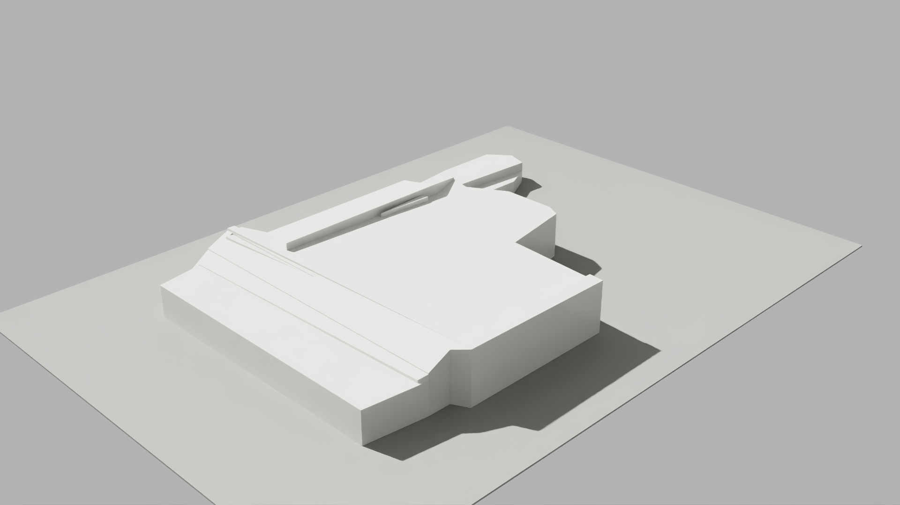

# College Park post office: historical building form

October 30, 2026. Added a separate historical form at 1705 Edgewater Drive. Current exterior, operation, entrances and parking access remain unverified. No facade was invented and no whole ticket is closed.

The public USGS 2018–2019 project cloud supports four roof/body components, a main roof approximately 6.38 m above the local ground reference, and a maximum modeled height of approximately 7.54 m. Roof projection union is approximately 1,679.74 m². These are interpreted historical components, not four confirmed physical buildings or occupied floors. The local flight date is unknown. The height datum is recorded as NAVD88 by the source receipt; the cached EPT header does not independently declare a vertical datum.

Independent checks verified source/cloud/node hashes, closed component shells and exact preservation of the selected geometry and world transforms. All-class-6 residual p50/p95 within the modeled footprint is approximately 0.050/0.332 m, with a 3.129 m maximum including lower/outlier returns. These statistics do not certify current conditions or an as-built survey. No visible legacy-building bounding-box overlap candidates were found; this conservative check is not a complete physical census.

## Actual isolated review

The actual render uses explicit Z-up/meters, a sharp camera and neutral lighting. Independent review found a coherent main roof/lower-wing mass without obvious spikes, crumpled planes or open voids. Narrow roof strips/steps remain interpreted source geometry; their architectural function is unknown.



[Source and independent visual review](evidence/post-office-readiness.json).

## Integration and recovery

The new `scene/post_office_historical.usda` is separate from the existing office layer. Only one root sublayer was added after manual edits; office geometry/material/detail layers, manual data, active snapshot and shared selection were preserved. A root backup and exact before/after hashes are recorded in [activation evidence](evidence/post-office-activation.json). The owner’s running editor was not reloaded or saved.

The scene builder validates source snapshot, exact canonical site identity, required source dependencies, source hashes and layer bytes before reusing the layer. Incorrect parcel IDs, missing dependencies, unsupported schema and attempted current/tax-link promotion are rejected. The reconstruction API now contains one historical site record, with `physical_building_count` unknown and `rendered_entity_count` one. Raw OCPA footprint links are not promoted. Corridor/reconstruction reports were rebuilt; the native refresh allowlist includes the new layer.

Rollback removes only this separate sublayer while retaining current root/manual opinions. Do not replace later user work with an old root backup. Source and review packages stay recoverable under ignored `data/diagnostics/post_office_historical_mass_20261030`.

The integrated render command was rejected by automatic approval review with `blocked by policy`, without a specific reason. It did not create a render process or review wrapper, and no equivalent retry or bypass was used. Therefore **in-scene visual acceptance remains pending**, while source/preservation and isolated historical-mass review passed.

## Reproduce the isolated package

```text
python tools/prepare_landmark_render.py --site college_park_post_office --output data/diagnostics/<new-folder>
```

Requires the existing public source cache, source proposal/manifest and readiness evidence. Existing output directories are refused. Default office preparation remains unchanged. Preparation copies only the selected source geometry and bound materials, retains explicit units and authors a bounded review camera; it performs no activation, network acquisition or source overwrite.

Existing historical activation, full-current-building acceptance, road/sidewalk engineering and facade reconstruction remain distinct requirements under #6/#8/#11/#13/#32. The source-only [public-cloud canopy review](evidence/public-lidar-canopy-readiness.json) found no vegetation-classified returns and does not establish tree locations.
