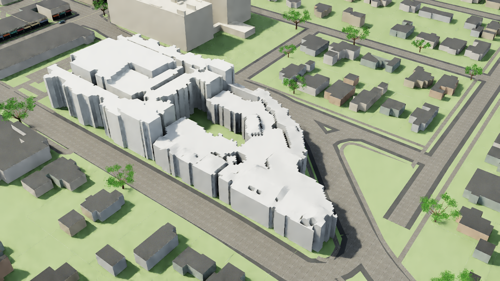

# Princeton roof: actual visual review

October 29, 2026 UTC. **The first coherent-plane proposal is rejected for activation.** The active roof has not been replaced. Neither the baseline nor this candidate meets the requested architectural presentation quality.

The original historical source cloud was replayed and the corrected candidate passed independent source-membership, support-distance, courtyard and joint-shell topology checks. Its 28 fitted planes cover approximately 2,699 m², with approximately 296 m² of separately labeled retained approximation. Those checks establish bounded geometric properties, not architectural or visual acceptance.

Two actual 1920×1080 Kit renders used the same camera, inherited lighting and verified neutral material binding. The candidate introduces visible triangular pits/fins, fragmented steps and microterraces across the foreground and curved eastern wing. The baseline already has serrated outlines and crude façades. Keeping it while repairs continue preserves existing work; it is not a quality endorsement.

## Baseline

## Rejected candidate

## Required correction

Replace nearest-support grid partitioning with a small number of connected roof regions whose shared ridges, valleys and level changes are supported by the source points. Use analytical plane intersections where the evidence establishes those relationships. Preserve genuine courtyard/roof openings. Unsupported regions must retain explicit uncertainty; do not smooth over gaps or assume hip/gable geometry merely because it looks plausible.

Before another full render, inspect a source-point/region overlay and quantify shared-boundary discontinuities. A new candidate must reduce artificial seams and pass the source/placement checks. Then repeat the same camera comparison and inspect the actual pixels. Do not conceal defects with blur, lighting or materials.

[Independent visual findings and image checksums](evidence/princeton-roof-visual-review.json) record the rejected layer `65eb74f6ffcaee3d79272569e2ea06f06b98a30f26f00adc411cb5960ef64a47`. The render inputs remain under local `data/renders/20261029T010149Z` and `data/renders/20261029T010301Z`. These are original model renders, not aerial-source pixels. Current building conditions and the western/middle unclassified source zones remain unresolved. No full ticket is closed by this review.
