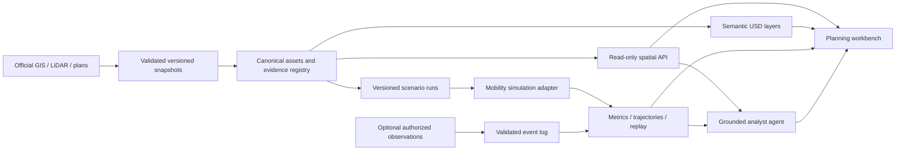

# College Park TWIN — smart-city platform plan

October 28, 2026. Supersedes the delivery ambition of the source-only plan; preserves its GIS work packages and acceptance requirements. This document is a proposed architecture and execution plan, not a deployment claim.

## Product outcome

Deliver an evidence-backed College Park platform for **both planning and live operations**, as confirmed by the project owner October 28, 2026. Cover the full College Park Main Street corridor, with Princeton–Edgewater as one priority showcase within that scope. Planning compares dated designs and repeatable mobility scenarios; operations connects authorized observations to the same mapped assets and supports reviewed alerts, search and replay. Both expose evidence, uncertainty and missing measurements.

Current foundation: local snapshot API/map, OCPA/City links and snapshot `20261028T160543372334Z` with 3,216 building groups, 3,916 parcel features and full official Main Street ground coverage. Historical LiDAR corrections, reviewed reconstruction layers, dated road references and material quality tiers extend that foundation. Terrain remains flat and streetscape placement remains partly illustrative. Counts and corrections are version-specific; these are partial capabilities, not a calibrated operational twin.

## Confirmed dual-purpose delivery contract

One canonical asset/evidence registry feeds two separately accepted products. A proposed design must never overwrite existing conditions; a simulated event must never appear as a live observation.

| Work package / existing tickets | Accountable AI role | Concrete deliverable and acceptance |
|---|---|---|
| Shared city foundation — #3–6, #15–18, #26 | GIS lead and scene engineer; Director reviews | Stable parcel/building/road IDs, dated references, CRS/datum, quality labels and scene/API agreement. Finish roof, road and sidewalk discrepancies before claiming accurate scenario results. |
| Planning — #21, #28 | Simulation analyst; PM coordinates | Baseline/proposed switch, explicit design changes, repeatable run IDs and seeds, comparable metrics and source-linked answers. Mobility claims require held-out count/travel-time validation. |
| Operations contract and recorded replay — #28, #29 | Vision/platform engineer; independent analyst evaluates | One authorized recorded use case with camera-to-map calibration, event/ingestion timestamps, confidence, evidence clip IDs, duplicate/late-event handling and stale-feed indicators. Measure false alerts/hour, precision/recall and latency before live rollout. |
| Bounded live operations pilot — #29, #13 | Platform engineer; Director accepts, VP reviews value | One authorized feed and defined area; verified host/profile, access controls, health/restart checks, retention, operator review and rollback. Set workload-specific latency and accuracy thresholds before testing. Alerts remain advisory; no automatic physical control is in scope. |
| Optional reconstruction/generation — #27, #30 | Reconstruction/AI evaluation engineer | NuRec requires suitable authorized overlapping captures. Cosmos outputs stay synthetic and are judged on held-out real observations. Adopt OSMO only when measured job scale warrants it. |

Reuse existing GIS acquisition, local API, semantic USD layers and ticket evidence. Do not start a second model or duplicate source ingestion for operations. The PM maintains dependencies and acceptance evidence; the Director owns integration/quality; the VP agent reviews scope and demonstrated benefit. Role assignment does not imply continuous background execution.

Implementation order: shared visual/data foundation → planning comparisons plus recorded observation replay → calibrated analytics → bounded live feed → measured expansion. Planning and recorded-replay contracts can progress together once shared identities are stable. Missing camera access does not block roof/road/model work.

NVIDIA documentation rechecked October 28, 2026: [VSS 3.3 introduction](https://docs.nvidia.com/vss/) describes modular real-time vision, downstream analytics and agent/offline processing. Select only the services needed by the pilot; pin their matched versions and deployment profile. The [June 2025 announcement](https://blogs.nvidia.com/blog/smart-city-ai-blueprint-europe/) supplies the create/test/deploy concept, while current product documentation governs implementation. Full-stack laptop compatibility remains unproven; see [runtime assessment](NVIDIA_RUNTIME_FEASIBILITY.md).

## Blueprint interpretation and technology decisions

The [NVIDIA article](https://blogs.nvidia.com/blog/smart-city-ai-blueprint-europe/) motivates a create/test/deploy loop around city twins and AI. The [current Smart City documentation](https://docs.nvidia.com/vss/vision-agent/agent-workflows/industry-specific-examples/smart-city-blueprint) describes simulation, training and deployment stages. Apply that loop to explicit local use cases rather than adopting every service at once.

| Capability | TWIN decision | Adoption gate |
|---|---|---|
| Omniverse / OpenUSD | Continue as 3D composition/rendering layer; semantic objects, scale, transforms and stable identities are required. | Asset/geometry contract, performance and reproducible build pass. |
| Traffic/pedestrian simulation | Evaluate SUMO for network-scale mobility; keep rendering decoupled from simulation. | Network geometry, demand evidence and held-out calibration checks. [SUMO documentation](https://eclipse.dev/sumo/docs/) describes relevant capabilities. |
| Cosmos / synthetic generation | Optional experiment after a sensor-specific evaluation objective exists. Generated imagery is never ground-truth geometry. | Geometry/label consistency, compute feasibility and held-out real-data evaluation. |
| NeMo / model customization | Optional after a simple grounded retrieval baseline fails a measured task. | Documented baseline, training rights, held-out set and measurable benefit. |
| Metropolis / VSS | Optional authorized video analytics extension after replay works. | Approved source access, calibration, retention policy, precision/recall and false-alert evaluation. |
| Geospatial storage | Start with existing files and local API; evaluate SQLite/GeoPackage or PostGIS as query volume/concurrency grows. | Measured need, migration/rollback and one canonical identity contract. |
| Event transport | Start with append-only versioned event files/local service; add a broker only if throughput/multi-consumer needs justify it. | Replay correctness and load test establish need. |

NVIDIA's [current prerequisite page](https://docs.nvidia.com/vss/vision-agent/agent-workflows/industry-specific-examples/smart-city-blueprint/prerequisites) lists Ubuntu 24.04, 128 GB RAM and validation on H100, L40S or RTX PRO 6000 Blackwell. The full reference stack is not assumed to fit the Windows laptop. Keep laptop rendering/local analysis separate from optional training and server inference. Pin exact versions, GPU memory requirements, licenses and expected operating costs before deployment; no purchase or cloud spend is authorized by this plan.

## Architecture

Control plane: configuration, permissions, source/model/run registry and audit history. Data plane: immutable snapshots, asset versions, events, simulation outputs and render assets. Derived metrics always link back to a run or observation; no LLM computes authoritative spatial measurements by guessing.

## Contracts that make this a twin

| Contract | Required fields and invariants |
|---|---|
| Asset | Stable asset ID; type; source feature IDs; parcel/building relationships; geometry/version; CRS/units; vertical datum; validity interval; observed/estimated/proposed status; uncertainty; evidence links; USD path. One parcel may contain several buildings/storefronts. |
| Observation/event | Event ID; asset/segment/sensor IDs; event and ingestion times; location/frame; observed/simulated/synthetic mode; measurement units; confidence; source/run ID; schema version. Late/duplicate records must not corrupt replay. |
| Scenario | Baseline snapshot; geometry/design revision; explicit parameter changes; demand/calibration inputs; simulator/config version; random seeds; time interval; source assumptions; author/reviewer. |
| Run/result | Run ID; input hashes; logs; status; trajectories; metric definitions/units/aggregation; uncertainty/replicates; validation status; comparisons to identical baseline conditions. |
| AI answer | Question; spatial/time scope; exact query/tool calls; evidence IDs/dates; calculation output; limitations/abstention; model/version; latency. Proposed and historical evidence remain labeled. |

SimReady acceptance is task-specific: correct scale/origin, semantic class and identity, valid geometry/materials, ground anchoring, instancing/detail levels, and collision/traversability only where required and validated. Photorealism alone does not establish simulation readiness.

## Three decision demos

1. **Trust the block.** Select a building or curb frontage, inspect its source/date/height quality, see missing evidence and compare dated references. Export a discrepancy queue and a reproducible evidence packet.
2. **Compare Edgewater designs.** Switch existing/proposed layers; compare sidewalk area, parking count, tree placement and modeled solar shade at stated times. Add mobility runs only when the network/demand gate passes. Shade geometry is not thermal comfort or heat-island prediction.
3. **Ask and replay.** Ask “Which frontages have unresolved sidewalk widths?” or “What changed between these two scenarios?” Receive a source-linked answer, highlighted objects and a timeline replay. Demonstrate simulated events before considering live feeds.

## Execution waves and measurable gates

### Wave 0 — Product and feasibility contract

- Freeze block endpoints, coordinate/vertical conventions and reference date in existing #5/#17.
- Baseline current startup, memory, declared-resolution FPS, API latency and data/geometry coverage.
- Define metric formulas and a manually reviewed benchmark question set before implementation.
- Gate: exact demo scope and evidence inputs recorded; current unknowns remain visible; optional stack versions/hardware evaluated without installation commitments.

### Wave 1 — Evidence-backed, semantic pilot

- Finish bounded #3/#4/#19/#20/#16 discovery and exception review; expand #6 terrain only after unit/datum checks.
- Add canonical registry/semantic asset manifest and cross-check API/scene identity.
- Complete existing-condition geometry #17 and physically plausible placement #18.
- Gate: 100% pilot assets have identity, evidence/status and quality labels; unresolved dimensions excluded from definitive claims; no unexplained floating geometry; missing assets/topology/source mismatches reported.

### Wave 2 — Planning workbench and scenarios

- Deliver #21 as dated design changes over a frozen baseline; add scenario/run registry and metric comparison view.
- Quantify area, parking inventory and geometric shade with declared assumptions. Use a matching comparison area/time and identical metric formulas.
- Gate: same input/version/seed reproduces a run; metrics reconcile with hand-checked pilot examples; existing baseline hashes unchanged; comparative outputs disclose unverified design dimensions.

### Wave 3 — Calibrated mobility and grounded AI

- Evaluate SUMO adapter using accepted road/pedestrian network, turn counts, signal timing and demand observations where available. AADT alone cannot specify peak-hour movements.
- Separate calibration data from validation observations; run multiple seeds and sensitivity checks. The [SUMO calibrator documentation](https://eclipse.dev/sumo/docs/Simulation/Calibrator.html) explains measurement-driven flow adjustment and route-fit limits.
- Implement read-only spatial/query tools and answer provenance. Test 30 benchmark questions, including unknown, stale, conflicting and proposed-data cases.
- Proposed AI gate: at least 90% fully correct evidence-backed answers on the reviewed set, zero fabricated source IDs, and correct abstention on every deliberately unavailable-data case. This is a target, not a measured result.
- Mobility gate: agree error tolerances against available count/travel-time observations before calibration; report holdout error, missing evidence and uncertainty. If data is insufficient, retain exploratory status and do not claim traffic prediction or optimization.

### Wave 4 — Observation replay and optional vision experiment

- Implement time-indexed observed/simulated/synthetic events, deterministic replay and stale-feed indicators.
- Evaluate one bounded use case, such as a blocked curb ramp, with authorized recorded clips or labeled simulation. No individual identity tracking is needed for this demo.
- Optional synthetic-data experiment: baseline model → controlled rendered variation → label/geometry checks → held-out real-data comparison. Hold out locations/time periods to avoid leakage.
- Gate: report precision/recall, false alerts per hour, detection latency, calibration error and blind spots; synthetic-only evaluation cannot establish field performance. Adopt NVIDIA services only after task and hardware evidence supports them.

### Wave 5 — Operational release and corridor expansion

- Authenticated write operations if introduced, audit logs, model/data registry, health checks, recovery, permissions and retention controls for observation data.
- Benchmark separate workloads: scene rendering, simulation, AI answering and optional inference; record GPU/CPU/RAM/VRAM, resolution, p50/p95 latency and dropped events.
- Initial rendering target remains 30 FPS median at declared 1080p route, subject to existing #13 acceptance; current 720p observations do not satisfy it.
- Gate: Director/QA evidence review, documented deployment/runbook/cost envelope, human authorization for publication/external services; extend by accepted block, not unreviewed city-wide generation.

## Operating model and priorities

PM manages the dependency graph and evidence, Director resolves integration/quality gates, VP agent reviews value/scope at wave boundaries. Add bounded Simulation Engineer, AI Evaluation Engineer and Platform/MLOps roles with independent GIS/QA review. Reserve integration capacity; at most two implementation streams plus one review across the four available agent slots.

Next work: source/parcel/pedestrian discovery plus Wave 0/registry design. Scenario and AI development can use explicit fixtures while source acquisition continues, but cannot publish unvalidated local conclusions. The separate future scenario is now a core planning demo after baseline acceptance; optional water/flood context remains deferred. Video/training remains conditional. Existing #1–#25 retain their acceptance criteria; new platform tickets add contracts, simulation and decisions rather than duplicate source ingestion.

## NVIDIA technology refresh — verified October 28, 2026

This section replaces generic references to the 2025 announcement with the newer sources below. “Current” refers to the reviewed pages on this date; release pages can change. Pin actual repository tags, container digests and model IDs before implementation.

| Verified advance | Primary source/date | Change to TWIN plan |
|---|---|---|
| Agent-assisted scene preparation and SimReady profiles | [Scene preparation](https://developer.nvidia.com/blog/how-to-use-ai-agents-to-prepare-3d-scenes-for-simulation/), September 16, 2026; [SimReady workflow](https://developer.nvidia.com/blog/5-steps-to-create-simready-assets-for-robotics-with-frontier-ai-models/), October 8, 2026 | Add a task-specific city asset profile and an inspect → author additive layer → render → validate loop. Evaluate ovrtx/ovphysx integration on copies; collision/material requirements depend on use case. Robotics examples are patterns, not ready-made city profiles. |
| Omniverse NuRec reconstruction | [NuRec](https://developer.nvidia.com/omniverse/nurec), [release notes](https://docs.nvidia.com/nurec/release-notes/index.html) listing 26.06, July 2026 | Trial one storefront frontage using authorized overlapping captures and known control points. Use reconstruction as visual context; preserve GIS/terrain geometry as the measurement/collision authority. Assess novel views, alignment, semantics and runtime memory. Enhanced/generated appearance remains labeled. |
| VSS 3.3 | [Technical update](https://developer.nvidia.com/blog/lower-the-cost-of-building-and-running-visual-ai-agents-with-nvidia-vss-blueprint-3-3/), September 29, 2026; [release notes](https://docs.nvidia.com/vss/release-notes) | Evaluate modular recorded-video search, visual Q&A and alert verification. New build-vision skill, structured memory and adaptive video sampling are candidate tools, not installed capabilities. Benchmark exact model/profile for retained incident recall, latency and concurrent memory failures. |
| Cosmos 3 | [NVIDIA announcement](https://nvidianews.nvidia.com/news/nvidia-launches-cosmos-3-the-open-frontier-foundation-model-for-physical-ai/), May 31, 2026 | Compare a selected supported model against a simple baseline for scene/event reasoning or synthetic variation. Do not assume the newest model is compatible with every VSS profile or fits the laptop. World-model output cannot establish real parcel geometry, actual tenants or current conditions. |
| Physical AI Data Factory and OSMO | [Data Factory announcement](https://investor.nvidia.com/news/press-release-details/2026/NVIDIA-Announces-Open-Physical-AI-Data-Factory-Blueprint-to-Accelerate-Robotics-Vision-AI-Agents-and-Autonomous-Vehicle-Development/default.aspx), March 16, 2026; [OSMO](https://developer.nvidia.com/osmo); [current Cosmos Data Factory repository](https://github.com/NVIDIA/cosmos-data-factory) | Version generation/curation/evaluation jobs and datasets now; evaluate distributed orchestration only once batch workloads justify it. Repository migration notes mean legacy recipes must not be mixed with current skills. No cluster deployment or cloud spending is implied. |
| Agent-assisted engineering twin assembly | [OpenUSD workflow](https://developer.nvidia.com/blog/developing-an-ai-factory-digital-twin-with-an-agent-assisted-workflow/), October 21, 2026 | Reuse requirements → source assembly → additive USD revisions → simulation review. DSX is an AI-factory example, not a city package to deploy wholesale. Keep the College Park coordinate/evidence contracts. |

### Revised order

1. Semantic/evidence contracts plus one reproducible pilot build.
2. Agent-callable scene inspection and validation; improve existing tree/car/facade assets against a declared city use-case profile.
3. NuRec visual trial alongside ongoing verified GIS/terrain/pedestrian geometry. Acceptance depends on alignment and visual improvement, not on geometry guesses.
4. Grounded “Ask this block,” deterministic scenario comparisons and event replay.
5. Calibrated mobility where demand evidence exists; a bounded VSS 3.3 recorded-video trial after source authorization and hardware preflight.
6. Cosmos/Data Factory evaluation only after task, baseline and real holdout exist; OSMO orchestration only after a measured multi-machine workload appears.

### Technology adoption evidence

For each candidate record release/tag/digest, license and data rights, compatibility with current Kit/OS/CUDA/model profile, installation boundary, rollback, RAM/VRAM/disk needs, baseline result, task-specific quality metrics and cost. Pass/fail or reject explicitly. Do not silently upgrade the working Kit installation.

NuRec gate: check withheld alignment landmarks and view coverage; keep splats/rendered appearance separate from traversable/collision meshes. VSS gate: calibrated ROI/time synchronization, event-level precision/recall and false alerts/hour, stale/restart handling and bounded concurrency. Adaptive sampling must not discard short relevant events. Synthetic gate: preserve labels/geographic structure and show improvement on held-out real observations; model-based scoring alone is insufficient.

Current NVIDIA docs redirect some old 3.1 URLs to 3.3; the release notes describe older images as deprecated. Use a selected supported release and its matched manifests; do not assemble an untested mixture from old blogs and current defaults.

## What success looks like

### Platform execution tickets

- [ ] [#26 — Create semantic asset contracts and agent-driven SimReady validation](https://github.com/ajoiventures/TWIN/issues/26)
- [ ] [#27 — Trial NuRec reconstruction for one realistic Edgewater frontage](https://github.com/ajoiventures/TWIN/issues/27)
- [ ] [#28 — Build evidence-grounded Ask This Block and reproducible scenario replay](https://github.com/ajoiventures/TWIN/issues/28)
- [ ] [#29 — Evaluate VSS 3.3 and Cosmos for a bounded recorded-video use case](https://github.com/ajoiventures/TWIN/issues/29)
- [ ] [#30 — Benchmark Cosmos 3 data generation and OSMO workflow feasibility](https://github.com/ajoiventures/TWIN/issues/30)

Tickets retain role ownership, dependencies, technology feasibility gates and independent acceptance review.

A stakeholder can open one accurate block, identify what is known, compare a dated design, inspect reproducible metrics and ask a question whose answer traces to evidence. The team can replay a run, reproduce a finding and explain uncertainty. City-wide scale, live operations, physical accuracy and AI benefits must each be demonstrated separately.
